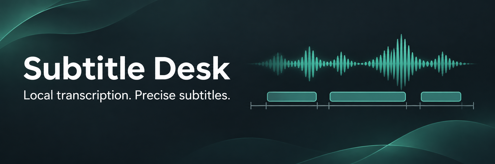
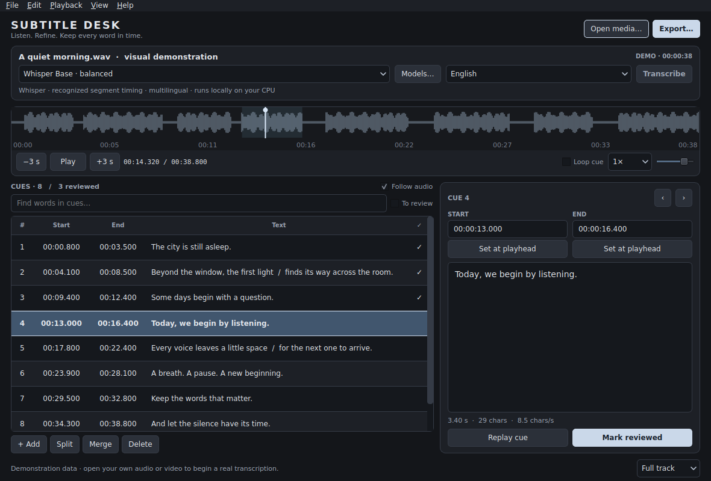
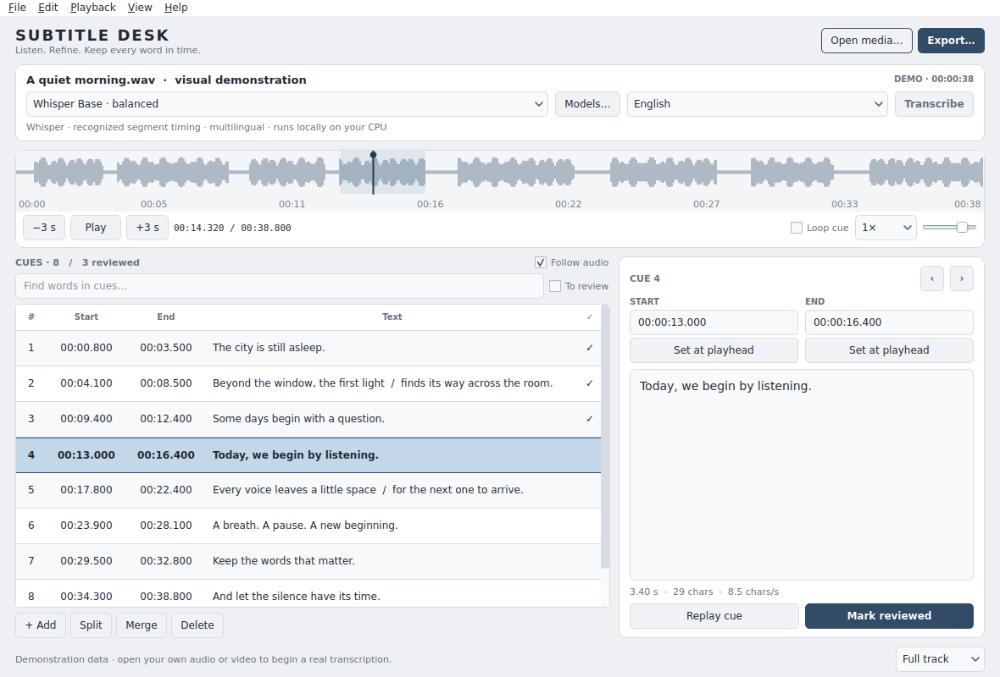
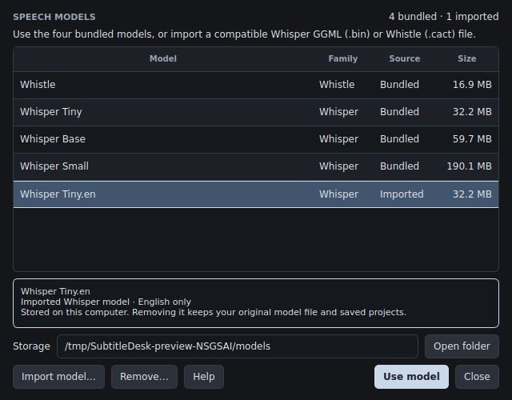
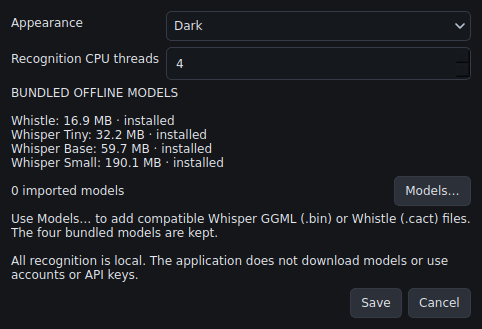
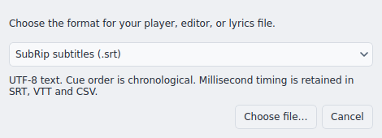

# Subtitle Desk 1.1.0

**Turn local audio and video into editable subtitles and synchronized lyrics.**

Subtitle Desk is a native C++/Qt desktop application for transcribing a file, listening back, and correcting its words and timing in one workspace. Four CPU speech models are bundled with the Windows and Linux packages, and you can install additional compatible model files through the Models manager. Recognition runs locally, with no account, API key, telemetry, or model download required after installation.

[Download 1.1.0](https://github.com/Davoda1/Subtitle-Desk/releases/tag/v1.1.0) · [User guide](docs/README.md) · [Install your own models](#install-your-own-models) · [Build instructions](docs/BUILDING.md) · [Tests and verification](docs/Verification.md) · [Changelog](CHANGELOG.md)

## Features

- **Local transcription:** Cactus Whistle and multilingual Whisper Tiny, Base, and Small, all running on the CPU.
- **Your own models:** import compatible whisper.cpp GGML `.bin` or Whistle `.cact` files, validate them with the bundled engine, and select them alongside the four bundled choices.
- **Audio-focused review:** waveform seeking, active-cue highlighting, cue replay and looping, and playback from 0.5× to 2× speed. Listening does not move your text-editing selection.
- **Direct editing:** change text and start/end times; set boundaries from the playhead; add, split, merge, delete, sort, or shift cues; undo and redo changes.
- **Review tools:** search cue text, mark checked cues, filter remaining work, and inspect timing and readability warnings.
- **Portable projects:** save editable `.sdesk` projects with exact timing, review marks, and a link to the original media. Unsaved edits have periodic recovery.
- **Seven export formats:** SRT, WebVTT, ASS, LRC, TXT, CSV, and JSON.
- **Desktop appearance:** System, Light, and Dark themes, with a minimum window size of 680 × 540.

## Screenshots

The running application, showing its built-in demonstration content.

### Dark theme



### Light theme



<details>
<summary>Models, settings, and export options</summary>

**Models**



**Settings**



**Export options**



</details>

## Download and install

Download the complete 1.1.0 package for your platform from [Releases](https://github.com/Davoda1/Subtitle-Desk/releases/tag/v1.1.0). Keep the executable and its accompanying folders together.

| Platform | Package | Start |
| --- | --- | --- |
| Windows 10/11, x64 | `SubtitleDesk-1.1.0-Windows-x64.zip` | Extract the ZIP and open `SubtitleDesk.exe` at its root. |
| GNU/Linux, x86-64 | `SubtitleDesk-1.1.0-Linux-amd64.tar.gz` | Extract the archive and run the `subtitledesk` binary at its root. |
| Debian-compatible GNU/Linux, amd64 | `SubtitleDesk-1.1.0-Linux-amd64.deb` | Install the package and open Subtitle Desk from the application menu. |

On Debian-compatible systems, install the downloaded package with:

```sh
sudo apt install ./SubtitleDesk-1.1.0-Linux-amd64.deb
```

The Debian package installs a real executable at `/usr/bin/subtitledesk` and supporting files under `/usr/lib/subtitledesk`. Linux requires a graphical desktop and system audio libraries; Qt, the decoder, and recognition models are included. Build and runtime compatibility details are in the [build guide](docs/BUILDING.md).

The distribution provides a single SHA-256 checksum manifest. Source archives contain the application, tests, and build scripts; model weights and the Qt SDK are acquired separately when building from source.

## First transcription

1. Choose **Open media…** or drop a local file onto the window. Common inputs include MP4, MKV, WebM, MOV, AVI, MP3, WAV, FLAC, M4A, AAC, OGG, and Opus; support depends on the codec inside the file.
2. Select a speech model and language. **Whisper Base** is the default; **Auto language** lets the engine identify the language.
3. Click **Transcribe**. A successful result replaces the cue list and can be undone. Cancelling or failing a job preserves the existing cues.
4. Play the audio and correct the highlighted cues. Double-click a row to replay it, adjust the start/end fields, and mark it reviewed when finished.
5. Save a **`.sdesk` project**, then choose **Export…** for the subtitle, lyrics, or transcript format you need.

Subtitle Desk processes the **first audio stream** and does not display video. Playback and recognition use the same temporary 16 kHz mono review track, while the original file remains unchanged. Audio offsets and gaps are retained to preserve alignment with the source timeline.

For a tour without opening a file, choose **Help → Open demonstration**. The [user guide](docs/README.md) explains editing, imports, shortcuts, recovery, and exact format behavior. An offline [HTML manual](docs/README.html) is also included in the runtime packages.

## Bundled models

All four models run without a GPU. The sizes below are the model files alone, rounded to decimal megabytes; they are not total memory requirements.

| Model | Model file | Use and language support |
| --- | --- | --- |
| Cactus Whistle | 16.9 MB | Compact recognizer with word timestamps grouped into cues. English, German, French, Spanish, Italian, Dutch, and Polish. |
| Whisper Tiny, Q5_1 | 32.2 MB | Smallest bundled Whisper model; a fast draft option with multilingual recognition. |
| Whisper Base, Q5_1 | 59.7 MB | Default Whisper model; a balance of size and processing work, with multilingual recognition. |
| Whisper Small, Q5_1 | 190.1 MB | Largest bundled Whisper model; an alternative to compare on difficult material, with higher processing requirements. |

Whisper supplies segment timestamps. All recognition timings are estimates and should be checked against the audio. Singing, background music, overlapping voices, and unfamiliar names can require substantial correction. The editor produces line-timed lyrics and subtitles; it does not provide automatic word-level karaoke alignment or speaker diarization.

## Install your own models

Choose **Models…** beside the model selector or **View → Models…**, then **Import model…**. Select a compatible model file and optionally give it a display name. The application copies it into its model storage, checks its structure, and asks the bundled engine to load it. Progress and cancellation remain available while it works. Only a successful import adds a selectable model.

| Accepted file | Requirements |
| --- | --- |
| Whisper `.bin` | A whisper.cpp GGML speech model supported by the bundled recognizer, including compatible quantized, English-only, and multilingual variants. |
| Whistle `.cact` | A compatible Whistle audio model with the required audio manifest; a general Needle text model is not sufficient. |

A filename extension alone does not establish compatibility. PyTorch `.pt`, Safetensors, general-purpose GGUF/LLM files, archives, and executables are not supported. Files must be between **1 MB and 8 GiB**, and engine validation has a **five-minute limit**. Larger compatible models can need much more memory and CPU time than the bundled choices. The application does not convert model formats or download models.

An imported file is copied; your original is left in place. Duplicate content reuses the existing installation. Imported models can be removed through the manager when they are not being used by a transcription job; bundled models are protected. A model-use lock also protects imported weights across running application instances, allowing one instance at a time to transcribe with a given imported model. English-only Whisper models offer Auto/English, while Whistle retains its seven-language selection. Obtain models from a source you trust and follow their own licenses.

Models are stored in the `models` subfolder of the [application data location](#settings-and-privacy). Projects save a model's stable identifier, not its weights or installation path. Opening a project without that model preserves its cue data and shows the unavailable choice; install the matching model or choose another before transcribing.

## Formats

| Format | Import | Export | Timing and purpose |
| --- | --- | --- | --- |
| SRT | Yes | Yes | Millisecond start/end times for video subtitles. |
| WebVTT | Yes | Yes | Millisecond start/end times for web video and compatible players. |
| ASS / SSA | Yes | ASS | Centisecond start/end times; exports use a neutral subtitle style. |
| LRC | Yes | Yes | Centisecond line starts for synchronized lyrics; end times are inferred on import. |
| TXT | — | Yes | Plain transcript without timing. |
| CSV | — | Yes | Millisecond timing, text, cue IDs, and review marks for spreadsheets. |
| `.sdesk` / JSON project | Yes | Yes | Editable project data, including exact times, review marks, model, language, and media link. |

Exports use UTF-8. Imported subtitle effects and styling become plain editable text. CSV protects formula-like text cells with an apostrophe; your project text stays unchanged. A project links to media rather than embedding it, so keep the source file available or use **File → Link / replace audio…** after moving it.

## Settings and privacy

Settings, recovery, and imported models are stored in `%AppData%\SubtitleDesk` on Windows or `~/.config/SubtitleDesk` on Linux, respecting `XDG_CONFIG_HOME`. To keep them beside a portable executable, create an empty `portable.flag` file before launch; the application uses a writable `data` subfolder instead.

Transcription and decoding are local. No cloud service, credential storage, or telemetry is used. Temporary decoded audio is removed when its session ends normally. Saved projects and exports contain your text and may contain media paths, so review them before sharing.

## Build, test, and contribute

The application uses **C++17, CMake 3.22+, and Qt 6.8.3** for the supplied runtime. Build on Linux with GCC or on Windows with the matching MinGW toolchain. The [build guide](docs/BUILDING.md) covers runtime acquisition, native builds, packaging, and tests.

Automated checks cover document formats, editor behavior, media decoding, real speech recognition with all four bundled models, custom model import and cancellation, and packaging. The Linux/Windows CI workflow includes the additional-model fixture and integration tests. See [test scope and limitations](docs/Verification.md) and the [Actions results](https://github.com/Davoda1/Subtitle-Desk/actions) for verification of a particular commit.

Bug reports and focused contributions are welcome. Read [CONTRIBUTING.md](CONTRIBUTING.md) for reproduction details and the build workflow, or [SECURITY.md](SECURITY.md) for sensitive reports.

## License and dependency provenance

**Copyright (c) 2026 davoda1.** Subtitle Desk is licensed under the [GNU Affero General Public License, version 3 only](LICENSE) (`AGPL-3.0-only`). See [NOTICE](NOTICE) for the application copyright and license notice. The canonical license text is included in the source and runtime packages.

Qt, FFmpeg, the recognition engines, model weights, and their dependencies retain their own licenses. Preserve the bundled notices when redistributing binaries. The [runtime lock](vendor/runtime-lock.json) pins distribution URLs, versions, model sizes, and SHA-256 hashes; the [FFmpeg provenance record](vendor/ffmpeg/provenance.json) identifies its vendored headers. Runtime components are acquired from the checksum-verified public Speech Desk distribution; Subtitle Desk has its own application source and executable. See the [build guide](docs/BUILDING.md#dependency-sources-and-redistribution) and [third-party licenses](vendor/licenses) for details.
